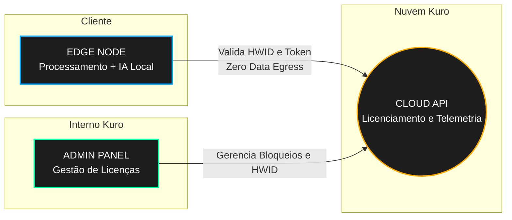
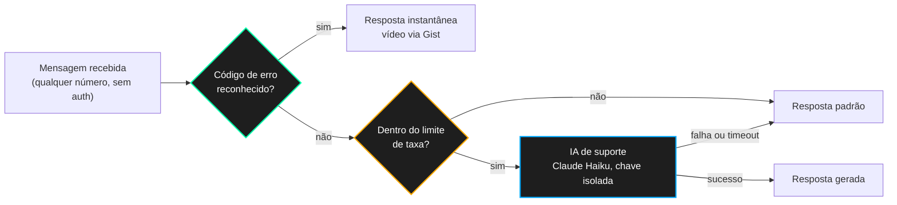
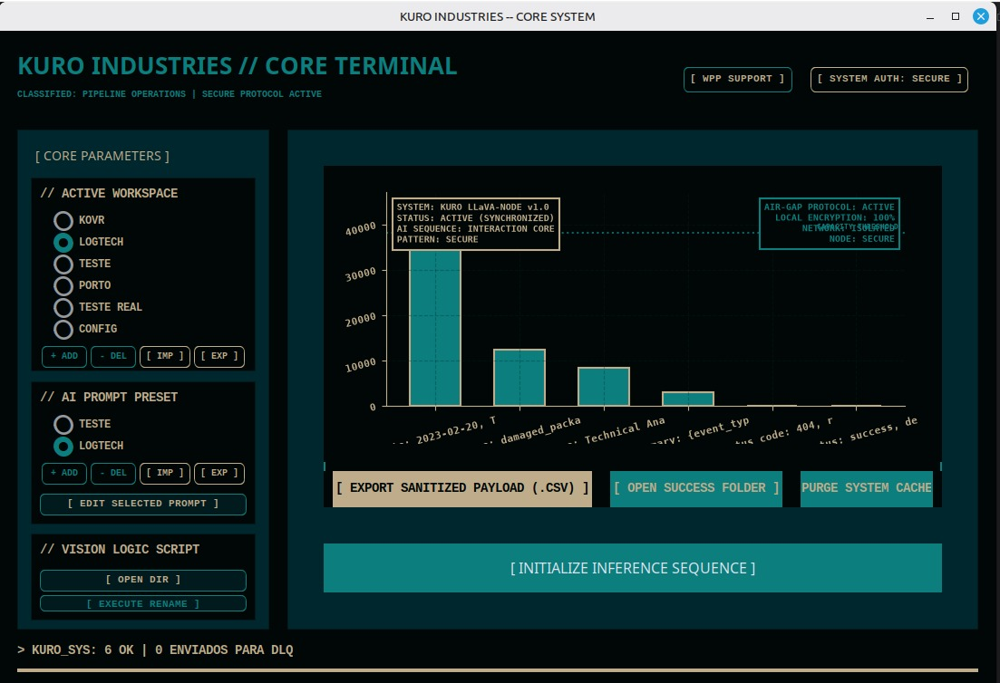
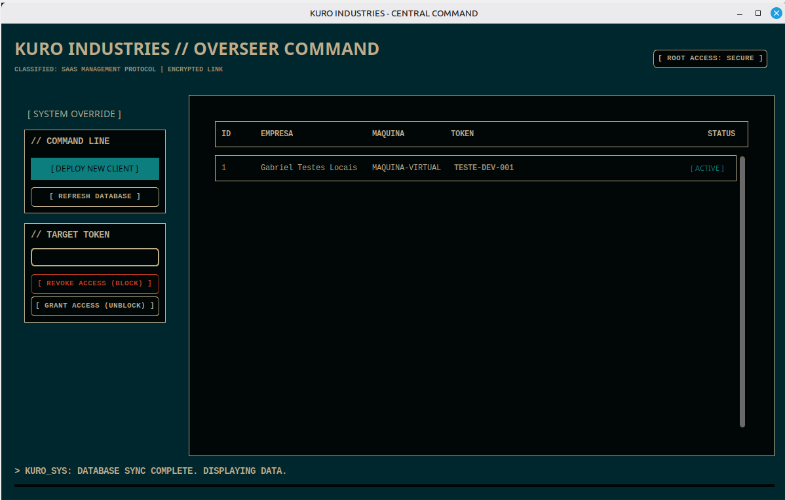

# Kuro Industries — Edge AI Data Processing Platform

**Estudo de Caso Técnico:** Arquitetura de processamento de dados sensíveis com IA local e licenciamento *Zero Trust*, projetada para operar inteiramente dentro da infraestrutura do cliente.

---

## O Problema

Processar planilhas de negócio com inferência de IA quando os dados **não podem**, por exigência contratual, sair da máquina do cliente. 

Isto descarta qualquer arquitetura SaaS centralizada convencional e exige repensar de onde para onde cada responsabilidade se move: o processamento de dados e a inferência de IA devem ocorrer **100% localmente**. A nuvem existe apenas como um *gatekeeper* para governar quem tem o direito de executar o software.

---

## Visão Geral da Arquitetura

A solução foi desenhada em três serviços fisicamente isolados, cada um com uma única responsabilidade e uma única audiência:

> **Regra de Isolamento Físico:** esta segregação não é apenas conceitual, é uma regra de processo. Os três repositórios nunca são aninhados um dentro do outro. Isto garante que o código-servidor e as ferramentas administrativas jamais sejam acidentalmente empacotados no instalador distribuído ao cliente final.

---

## Motor de Processamento

O núcleo do sistema foi projetado para eficiência de memória e resiliência contra dados mal formatados:

- **Avaliação Preguiçosa (Lazy Evaluation):** a leitura, validação e deduplicação de planilhas via Polars constrói um plano de execução antes de ler qualquer linha, evitando carregar o arquivo inteiro em memória.
- **Inferência de IA em Blocos:** a etapa mais cara (LLMs locais) consome dados em lotes de tamanho fixo. O pico de memória permanece constante independentemente de o arquivo ter 1.000 ou 500.000 registros, mantendo o uso de RAM achatado.
- **Fila de Mensagens Mortas (Dead Letter Queue):** nenhum erro de formatação interrompe o processamento do lote. Registros problemáticos são isolados em uma DLQ com o motivo exato do erro para auditoria, nunca descartados silenciosamente.
- **Disjuntor (Circuit Breaker):** falhas consecutivas na IA são tratadas como indisponibilidade do serviço (não erro de dado), interrompendo a tarefa de forma controlada para evitar ruído.
- **Motor de Regras Plugável:** a lógica de negócio é carregada dinamicamente. Colunas, formatos e vocabulário são definidos por configuração declarativa, não no código-fonte, permitindo uma alternativa (fallback) para regras genéricas.

## Pipeline Condicional de IA e Visão Computacional

Abstraímos a complexidade da interação com modelos locais para o usuário final:

- **Auto-Prompting Inteligente:** o operador descreve sua intenção em linguagem natural no frontend. Um modelo menor redige e salva um prompt profissional otimizado no perfil do cliente para inferências futuras.
- **Extração Multimodal (LLaVA):** para registros com imagens anexas, o sistema aciona uma segunda etapa de inferência com um modelo de visão computacional local. A arquitetura garante que esta etapa pesada seja ignorada em registros puramente textuais.

## Camada de Licenciamento (Zero Trust)

Sem ofuscação de binário e sem visibilidade dos dados processados, a proteção da propriedade intelectual depende 100% do protocolo Edge-Cloud:

- **Vínculo por Hardware (Trust-on-First-Use):** cada licença vincula-se ao hardware (UUID) na primeira ativação válida. Tentativas de uso em outras máquinas são recusadas automaticamente pela API.
- **Cache Offline Assinada (HMAC-SHA256):** o sistema tolera instabilidade de rede operando em um período de carência. A integridade do arquivo `.kuro_sync` é garantida por assinatura associada ao HWID da máquina. Mudar a data ou copiar o arquivo invalida o acesso via comparação de tempo constante (`hmac.compare_digest`).
- **Resposta Assimétrica a Falhas (Killswitch):** a thread de licenciamento distingue erros definitivos (401/403) de instabilidades (5xx/Timeout). Apenas recusas definitivas encerram o processo na hora, prevenindo que o sistema caia por instabilidade da API.
- **Princípio do Menor Privilégio:** o Edge Node possui apenas tokens limitados ao próprio cliente, nunca trafegando a chave mestra (`X-API-KEY`) administrativa nas validações.

## Privacidade desde a Concepção (Privacy by Design)

O maior inibidor de adoção de IA no ambiente corporativo é o risco de vazamento de dados. Esta arquitetura trata isso como um requisito estrutural:

- **Zero-Data Egress:** o processamento ocorre 100% no cliente. A Cloud API atua exclusivamente como gatekeeper de licenças e nunca recebe dados, planilhas ou conteúdo de negócio.
- **Superfície de Auditoria Reduzida:** ao garantir inferência no Edge, eliminamos a necessidade de Acordos de Processamento de Dados (DPAs) com provedores de nuvem (ex: OpenAI, AWS), facilitando a conformidade com frameworks como LGPD e GDPR.

## Automação de Suporte via WhatsApp

Integrado diretamente ao mesmo backend de licenciamento, sem infraestrutura adicional (via Meta Cloud API):

- **Notificação Proativa:** alertas automáticos ao fim de pipelines longos, eliminando acompanhamento manual.
- **Suporte Técnico Auto-Atendido:** os usuários enviam códigos de erro e recebem vídeos curtos de resolução.
- **Gist Cache Fallback:** a base de conhecimento roda em um Gist público com TTL em memória. O suporte é atualizável em tempo real, sem necessidade de novas implementações, e degrada graciosamente servindo a última cache válida caso o GitHub fique indisponível.

---

## Ecossistema SaaS: Suporte Agentic e Painel Administrativo

A mesma nuvem que licencia o Edge Node sustenta a operação do produto. Três decisões atravessam esse lado do sistema:

- **Falha fechada:** toda rota administrativa exige `CHAVE_MESTRA` vinda de variável de ambiente; sem ela o serviço **recusa subir** (corrige uma credencial padrão fixa no código, CWE-798, achada em auditoria).
- **IA como última linha:** o lookup determinístico de código de erro roda primeiro; a IA generativa só entra quando ele não resolve, e o texto do cliente nunca é concatenado ao prompt de sistema.
- **Entrada não confiável por padrão:** o webhook do WhatsApp recebe texto de qualquer número, sem autenticação, e o desenho assume isso desde a primeira linha.

| Defesa | O que faz |
|---|---|
| **Chave isolada** | `ANTHROPIC_API_KEY_SUPORTE`, nunca a chave do plano de controle interno; sem ela, o bot simplesmente não chama a IA |
| **Isolamento de prompt** | texto do usuário só entra como mensagem `user`; prompt de sistema fixo no código |
| **Rate limiting** | 5 chamadas por número por hora (janela deslizante), teto de custo contra flood |
| **Truncamento** | mensagem cortada em 500 caracteres antes da IA |
| **Timeout + tentativa única** | 3s de conexão, 6s de leitura, sem retry |
| **Fallback determinístico** | qualquer falha cai na resposta padrão; o cliente nunca vê erro técnico |

**Kuro Admin v2 (desktop, CustomTkinter):** painel interno com tabela de clientes (atividade, status de pagamento, versão do software), cada campo ligado a um campo real da API. A chave mestra é pedida uma vez, **nunca vai para o disco** e a validação roda em thread separada, sem travar a interface.

**Infraestrutura:** API Flask/Gunicorn no Render; PostgreSQL no Supabase via Supavisor (modo Transaction, porta 6543, endereço IPv4 compatível com o Render); `pool_pre_ping` e `pool_recycle=280` contra conexões ociosas; fallback para SQLite local sem `DATABASE_URL`.

> **Estado real:** a integração Render + Supabase + domínio está em configuração, não validada de ponta a ponta em tráfego real. O bot foi testado contra o número de teste da Meta. As três ações de IA local do painel (alerta de inadimplência, resumo da frota, triagem de causa-raiz) têm gancho de interface, mas a chamada ao modelo ainda não foi implementada.

Detalhes completos, roadmap e limitações: [estudo de caso do ecossistema SaaS](docs/kuro-saas-ecosystem.md).

---

## Engenharia de Qualidade

A estabilidade da ponte Edge-Cloud é rigorosamente testada:

- **81 Testes Automatizados:** cobrem os backends contra vetores adversários (adulteração de cache offline, clonagem de HWID, simulação de timeouts e payloads mal formatados).
- **Integração Real:** o CI/CD roda contra instâncias reais de PostgreSQL (via GitHub Actions), garantindo que o comportamento reflita o ambiente de produção.
- **Regressão de Performance:** testes empíricos com dados sintéticos em escala para comprovar (e não apenas assumir) o comportamento de memória do motor de processamento.

## Stack Técnica

- **Edge Node:** Python, Polars, CustomTkinter, LLaVA / LLMs Locais (inferência on-device)
- **Cloud API:** Flask, SQLAlchemy, PostgreSQL, Meta Cloud API
- **Painel Administrativo:** Python, CustomTkinter (Kuro Admin v2)
- **IA de suporte:** Claude Haiku com chave isolada e fallback determinístico
- **DevOps / Qualidade:** pytest, GitHub Actions, Render

## Maturidade e Limitações Conhecidas

Este projeto documenta tanto suas decisões deliberadas quanto suas limitações conhecidas, atualmente priorizadas no roadmap técnico:

- **Migração de Schema:** sem integração formal com o Alembic; alterações de banco de dados em produção dependem de comandos `ALTER TABLE` manuais e idempotentes na inicialização (suporta novas colunas, mas falha em mutações complexas).
- **Rate Limiting:** apenas o caminho de IA do suporte via WhatsApp tem limite por número; as demais rotas públicas da API ainda não possuem limitação de taxa estrita.
- **Painel Admin:** o Kuro Admin v2 já lista a base de clientes, mas ações de manutenção de infraestrutura (redefinir HWID, atualizar telefone) ainda são feitas diretamente via chamadas de API.

---

## Demonstração

