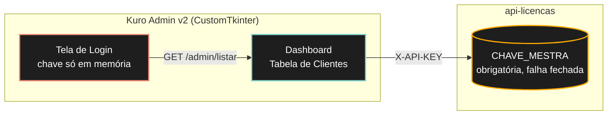
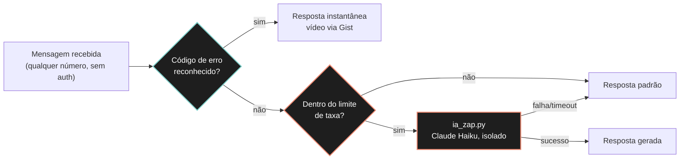

# Kuro Industries — SaaS Licensing & Support Ecosystem

**Estudo de Caso Técnico:** arquitetura de licenciamento Zero-Trust, automação de suporte agentic via WhatsApp e um painel administrativo desktop com defesa em profundidade, para um produto de ETL com IA local vendido a clientes corporativos.

---

## 1. Resumo executivo

O **Kuro Core** (Edge Node, ver estudo de caso irmão) processa dados sensíveis 100% na máquina do cliente. Esse ecossistema é a contraparte que torna isso um **produto**: uma API de licenciamento Zero-Trust que nunca vê dado de negócio, um bot de suporte que mistura lookup determinístico com IA generativa de forma controlada, e um painel administrativo desktop para a equipe interna gerenciar a base de clientes — sem nunca expor a chave mestra de administração em texto fixo no código, o erro de segurança mais comum em software B2B pequeno.

**Três decisões atravessam o ecossistema inteiro:**
- **Zero-Trust na borda:** toda rota administrativa exige uma chave forte vinda de variável de ambiente; sem ela, o serviço **recusa subir** (falha fechada), não degrada para um modo inseguro.
- **IA como última linha, nunca a primeira:** tanto no suporte via WhatsApp quanto no painel administrativo, a regra é a mesma — cálculo e busca determinística ficam em código testável; a IA generativa só entra quando o caminho barato não resolve, e nunca decide sozinha algo que o código já pode provar.
- **Superfícies de entrada não confiáveis são tratadas como tal.** Um webhook de WhatsApp recebe texto de qualquer número do mundo, sem autenticação alguma — o desenho assume isso desde a primeira linha, não como correção posterior.

---

## 2. Arquitetura de front-end — Kuro Admin v2

### Identidade visual herdada, não reinventada

O painel administrativo compartilha o sistema de design do **Kuro Tracker** — mesmos tokens hexadecimais, não uma aproximação visual: fundo **Ink** (`#000706`), ação em **Mint** (`#7fd1cb`), estado crítico em **Coral** (`#f08a72`), bordas de baixo contraste, geometria consistente (cantos de 12px em cards, 8px em controles). A regra herdada junto com os tokens: **cor de estado só aparece em dado, nunca em decoração** — um badge "Atrasado" é coral porque *é* um dado crítico, não porque a tela "precisa de cor".

A **Tabela de Clientes** é o componente central: uma linha por cliente com indicador de atividade (ponto mint para online, cinza para offline), badge de status de pagamento e a versão do software em uso — cada campo ligado a um campo real da API (`/admin/listar`), nunca inventado para preencher a tela.

### Modelo de segurança: chave única, nunca em disco

A API de licenciamento não tem conceito de usuário — é uma **chave mestra compartilhada** (`CHAVE_MESTRA`) validada no cabeçalho `X-API-KEY`. O painel reflete esse modelo com honestidade em vez de simular um login que a API não suporta: a tela de autenticação pede a chave uma vez, ela **nunca é escrita em disco**, vive só na instância em memória do processo, e a chamada de validação roda em thread separada — a interface nunca trava esperando a rede.

**Falha fechada em dois níveis:**
- No servidor (`api_servidor.py`): sem `CHAVE_MESTRA` configurada no ambiente, o processo **recusa iniciar** — corrige uma vulnerabilidade real encontrada em auditoria (CWE-798, credencial padrão fixa no código-fonte).
- No cliente desktop: uma chave incorreta nunca chega a autenticar nenhuma chamada; o erro de autenticação é distinguido explicitamente de erro de rede, para o operador saber se o problema é a chave ou a conexão.

> **Estado de maturidade, com honestidade:** o armazenamento opcional de sessão via **DPAPI do Windows** (mesmo mecanismo já em produção no Kuro Inventory Pricing, `CryptProtectData`/`CryptUnprotectData`, blob que só abre na mesma conta do Windows que o gerou) está **arquitetado e aprovado, não implementado** — hoje a chave vive só em memória de processo; "lembrar por N dias" criptografado é o próximo incremento, não uma funcionalidade já entregue.

### IA local (Ollama): desenho aprovado, gancho de UI pronto, integração pendente

O painel tem três ações de IA local já posicionadas na interface (alerta de inadimplência, resumo executivo da frota, triagem de causa-raiz por cliente) seguindo uma regra de separação estrita: **o código calcula, a IA só redige.** Contagem de dias sem heartbeat, proporção de erros na fila de rejeição (DLQ) e cruzamento com status de pagamento são sempre funções Python puras e testáveis; a IA (Ollama local, nunca uma API externa — os dados são metadados agregados de **todos** os clientes, superfície grande demais para sair da máquina) entraria só para transformar o número já calculado em uma frase acionável para o operador.

> Hoje os três botões existem na interface e documentam a intenção; a chamada ao modelo ainda não foi implementada — é a próxima frente de trabalho do painel, não parte do que já roda.

---

## 3. Motor de suporte agentic — WhatsApp

O `ia_zap.py` é o módulo que decide o que responder quando o lookup determinístico de código de erro (`suporte_zap.py`, baseado num Gist de código→vídeo, instantâneo e sem custo) não reconhece a mensagem. A ordem importa: **o caminho barato sempre tenta primeiro**, e é testado explicitamente para nunca acionar a IA quando o lookup resolve sozinho.

**Defesas implementadas e verificadas por 44 testes automatizados** (11 específicos do módulo de IA, 2 de integração do roteamento, 31 do restante da API — persistência, heartbeat, notificação, suporte via Gist):

| Defesa | O que faz | Por quê |
|---|---|---|
| **Chave isolada** | `ANTHROPIC_API_KEY_SUPORTE`, nunca a chave do Control Plane interno | Um bot público comprometido não compromete a infraestrutura de orquestração |
| **Isolamento de prompt** | O texto do WhatsApp entra só como mensagem `user`; o prompt de sistema é fixo no código e nunca recebe concatenação do texto do cliente | Webhook sem autenticação = qualquer um pode tentar injeção de prompt; testado explicitamente (`test_texto_do_usuario_vai_so_em_messages_nunca_no_prompt_de_sistema`) |
| **Rate limiting em memória** | 5 chamadas por número de telefone por hora, janela deslizante | Teto de custo contra flood — decisão de negócio, não de segurança, e documentada como tal |
| **Truncamento** | Mensagem cortada em 500 caracteres antes de chegar à IA | Limita superfície e custo por chamada |
| **Timeout + tentativa única** | 3s de conexão, 6s de leitura, sem retry | Um webhook nunca pode travar esperando um provedor externo |
| **Fallback determinístico sem exceção** | Qualquer falha (rede, timeout, resposta malformada, chave ausente) cai na mesma resposta padrão de sempre | O cliente final nunca vê um erro técnico; o pior caso é indistinguível do comportamento anterior sem IA |

A chave isolada tem uma propriedade adicional: **o bot funciona sem ela.** Sem `ANTHROPIC_API_KEY_SUPORTE` configurada, o sistema simplesmente não tenta a chamada — não é um erro, é o estado padrão até a equipe decidir ligar a camada de IA.

---

## 4. Infraestrutura e nuvem

| Camada | Escolha | Papel |
|---|---|---|
| **Hospedagem da API** | Render (Web Service HTTP) | `api-licencas` roda como serviço Flask/Gunicorn standard, deploy contínuo a partir do repositório |
| **Banco de dados** | Supabase (PostgreSQL), via **Supavisor em modo Transaction, porta 6543** | Render não suporta saída IPv6 nativa para o endpoint direto do Postgres; o pooler do Supabase expõe um endereço IPv4 compatível. Conexão por `postgres.<ref-do-projeto>` (username roteado por tenant, multi-projeto no mesmo pooler) |
| **Resiliência de conexão** | `pool_pre_ping=True`, `pool_recycle=280` no SQLAlchemy | Supabase e Render reciclam conexões ociosas; testar antes de usar evita erro silencioso em produção |
| **Persistência sem banco** | Fallback para SQLite local quando `DATABASE_URL` não está definida | Ambiente de desenvolvimento funciona sem depender de infraestrutura externa |
| **Domínio** | `kuroindustries.com.br` | Endpoint de produção para licenciamento, telemetria e notificação — documentado como variável de ambiente (`KURO_API_URL`) em todos os clientes, nunca fixo no código |

> **Estado real no momento deste documento:** a integração Render ↔ Supabase está em configuração ativa (propagação de DNS do domínio em andamento); não é, ainda, uma afirmação de "está no ar" — é a arquitetura escolhida e em processo de validação.

---

## 5. Roadmap e próximos passos (go-live)

- [ ] **Apontamento final do webhook do Meta for Developers** com o número comercial oficial — bloqueado pela chegada física do chip pré-pago que serve de número de suporte; a integração técnica (verificação de token, parsing de payload, resposta) já está pronta e testada contra o número de teste da Meta.
- [ ] **Confirmação de DNS e deploy estável** do domínio `kuroindustries.com.br` apontando para o Render, com a conexão Supabase validada em produção.
- [ ] **Conectar a IA local (Ollama) ao painel administrativo** — as três funcionalidades propostas (alerta de inadimplência, resumo executivo, triagem de causa-raiz) têm o gancho de interface pronto; falta a chamada ao modelo.
- [ ] **Estado de sessão com DPAPI** no Kuro Admin v2 — arquitetura decidida (mesmo mecanismo do Kuro Inventory Pricing), implementação pendente.
- [ ] **Pipeline de empacotamento nativo** (`scripts/build_admin.py`): PyArmor ofuscando o código Python, PyInstaller gerando binário `--onedir` (mesma decisão de boot time do Kuro Tracker, medida em ~1s contra ~7s do modo `--onefile`), instalador "two-click" para Windows e Linux. Deliberadamente **não executado ainda** — o código do painel continua 100% editável em texto puro enquanto a integração de funcionalidades está em andamento; ofuscar cedo demais custaria velocidade de iteração sem benefício.

---

## Stack técnica

- **API/Backend:** Python, Flask, Flask-SQLAlchemy, Gunicorn, PostgreSQL (Supabase/Supavisor)
- **Automação de suporte:** Meta Cloud API (WhatsApp), Claude (Anthropic) como IA de suporte com fallback determinístico
- **Painel administrativo:** Python, CustomTkinter, threading para operações de rede não-bloqueantes
- **IA & Dados:** Ollama (planejado, local), Claude Haiku (suporte, isolado por chave própria)
- **Segurança:** variáveis de ambiente obrigatórias com falha fechada (CWE-798 corrigido), isolamento de chaves por função, rate limiting em memória, defesa contra injeção de prompt, DPAPI (planejado)
- **Qualidade:** 44 testes automatizados no backend, suíte própria para o módulo de IA de suporte, testes de integração do roteamento determinístico×generativo

---

## O que ainda não está provado

Honestidade é parte do desenho deste ecossistema, não um apêndice:

- O deploy de produção (Render + Supabase + domínio) está em configuração, não validado de ponta a ponta em tráfego real.
- As três funcionalidades de IA local do painel administrativo são propostas aprovadas com gancho de interface pronto — a integração com Ollama não foi codificada.
- O armazenamento de sessão via DPAPI é uma decisão de arquitetura herdada de outro produto do mesmo ecossistema, ainda não implementada neste.
- O bot de WhatsApp foi testado contra o número de teste da Meta for Developers; o volume e o comportamento com tráfego real de clientes, com o número comercial definitivo, ainda não foram observados.
- O empacotamento nativo (PyArmor + PyInstaller) é uma decisão de arquitetura com precedente direto em produção em outro produto do ecossistema (Kuro Inventory Pricing), mas ainda não foi executado para este painel.

